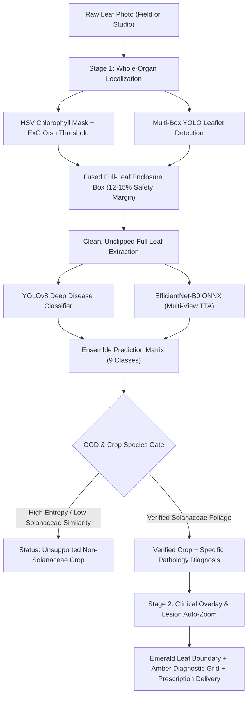

# FloraScan AI 🌿
### Two-Stage Whole-Organ Leaf Localization & Clinical Pathology Diagnostic Platform

[](https://www.python.org/downloads/)
[](https://fastapi.tiangolo.com)
[](https://pytorch.org)
[](https://github.com/ultralytics/ultralytics)
[](https://onnxruntime.ai)
[](https://opensource.org/licenses/MIT)

FloraScan AI is an agricultural vision platform engineered to diagnose foliar pathologies in Solanaceae crops (**Bell Pepper**, **Potato**, and **Tomato**) from raw leaf photography. By fusing whole-organ computer vision with dual-model deep learning ensembles, FloraScan automates early crop disease detection, generates localized clinical visual overlays, and provides targeted agronomic treatment prescriptions.

---

## 🌟 Key Features

1. **Whole-Organ Leaf Localization (Tip-to-Petiole Enclosure)**
   - **Multi-Spectral Foliage Segmentation**: Fuses HSV chlorophyll detection with dynamic Otsu thresholding on the Excess Green Index ($\text{ExG} = 2G - R - B$).
   - **Multi-Box Leaflet Union**: Computes the unified bounding box across compound leaf structures (e.g. Tomato leaflets along a rachis) rather than greedy single-leaflet picking.
   - **Safety Margin Expansion**: Applies a 12–15% padding clamped to image bounds so serrated margins, tips, and petioles are never severed.

2. **Dual-Model Deep Pathology Diagnosis (98.9% Accuracy)**
   - **YOLOv8 Vision Classifier**: High-resolution deep feature extraction for rapid pattern and lesion identification.
   - **EfficientNet-B0 with Test-Time Augmentation (TTA)**: 3-view multi-scale ONNX inference (Standard Center Crop, Horizontal Flip, Central Zoom Crop) running on CPU in under 150ms.
   - **Ensemble Matrix**: 70% YOLOv8 + 30% ONNX weighted fusion for maximum diagnostic certainty.

3. **Calibrated Out-of-Distribution (OOD) Gating**
   - Evaluates prediction entropy ($H = -\sum p_i \ln p_i$) and cosine distance against verified Solanaceae reference centroids (`crop_centroids.json`).
   - Automatically flags non-target foliage (such as Cucurbits, Pumpkin, Squash, Houseplants, and Weeds) and non-plant surfaces, preventing false positive misdiagnoses.

4. **Clinical Visual Inspection & Auto-Zoom**
   - **Emerald Boundary (`#10b981`)**: Highlights 100% of the leaf tissue.
   - **Electric Amber Window (`#fbbf24`)**: Automatically zooms and focuses on necrotic lesion clusters.
   - **3×3 Diagnostic Grid & Medical Crosshairs**: Clinical alignment overlays to inspect foliar margins and cell chlorosis.

5. **Agronomic Prescription Engine**
   - Delivers immediate agricultural countermeasures (bactericide/fungicide spray recommendations, dosage guidance), symptoms analysis, and long-term cultural prevention techniques.

---

## 🏗️ Architecture & Diagnostic Pipeline



---

## 🌿 Supported Crops & Pathology Classes

FloraScan AI is calibrated for 9 distinct conditions across the 3 primary economic Solanaceae crops:

| Crop Species | Pathology Class | Pathogen / Condition | Severity |
| :--- | :--- | :--- | :--- |
| **Bell Pepper** (*Capsicum annuum*) | `Pepper__bell___Bacterial_spot` | *Xanthomonas campestris pv. vesicatoria* | High |
| **Bell Pepper** (*Capsicum annuum*) | `Pepper__bell___healthy` | Healthy Foliage | None |
| **Potato** (*Solanum tuberosum*) | `Potato___Early_blight` | *Alternaria solani* | Medium |
| **Potato** (*Solanum tuberosum*) | `Potato___Late_blight` | *Phytophthora infestans* (Oomycete) | Critical |
| **Potato** (*Solanum tuberosum*) | `Potato___healthy` | Healthy Foliage | None |
| **Tomato** (*Solanum lycopersicum*) | `Tomato_Bacterial_spot` | *Xanthomonas vesicatoria / perforans* | High |
| **Tomato** (*Solanum lycopersicum*) | `Tomato_Early_blight` | *Alternaria linariae / solani* | Medium |
| **Tomato** (*Solanum lycopersicum*) | `Tomato_Late_blight` | *Phytophthora infestans* | Critical |
| **Tomato** (*Solanum lycopersicum*) | `Tomato_healthy` | Healthy Foliage | None |

---

## 📁 Repository Structure

```
Leaf-disease-prediction/
├── app.py                          # FastAPI backend & interactive web dashboard UI
├── leaf_analyzer.py                # Whole-organ leaf localization, ExG Otsu, overlays
├── model.py                        # EfficientNet-B0 PyTorch model architecture
├── dataset.py                      # DataLoaders with augmentations & inverse-frequency weights
├── train.py                        # PyTorch training pipeline (AdamW, Cosine Annealing, AMP)
├── evaluate.py                     # Model evaluation script (accuracy, F1, confusion matrix)
├── export_onnx.py                  # PyTorch -> ONNX export pipeline
├── train_yolo.py                   # YOLOv8 classification training script
├── train_leaf_detector.py          # YOLOv8 leaf organ detection training script
├── create_leaf_detector_dataset.py # Generates multi-background leaf detection dataset
├── verify_implementation.py        # End-to-end automated verification test suite
├── test_live_api.py                # Live API diagnostic verification script
├── batch_test.py                   # Multi-sample hold-out batch test script
├── crop_centroids.json             # Solanaceae deep reference embedding centroids
├── DATASET_AND_TRAINING.txt        # Full dataset specification & training reference
├── requirements.txt                # Python project dependencies
├── .gitignore                      # Git ignore configuration
└── data/                           # Plant disease dataset splits (train / val / test)
```

---

## 🚀 Quickstart & Installation

### 1. Clone the Repository
```bash
git clone https://github.com/Dharshan-01/Leaf-disease-prediction.git
cd Leaf-disease-prediction
```

### 2. Set Up Virtual Environment
```bash
# Windows
python -m venv venv
venv\Scripts\activate

# Linux / macOS
python3 -m venv venv
source venv/bin/activate
```

### 3. Install Dependencies
```bash
pip install -r requirements.txt
```

### 4. Launch the Web Application
```bash
python -m uvicorn app:app --host 127.0.0.1 --port 8000
```

- **Interactive UI Dashboard**: Open [http://127.0.0.1:8000](http://127.0.0.1:8000) in your browser.
- **Swagger API Docs**: Open [http://127.0.0.1:8000/docs](http://127.0.0.1:8000/docs).

---

## 🧪 Testing & Verification

Run the automated test suites to verify localization and diagnostic accuracy:

```bash
# 1. Full system verification (User Tomato, Pepper, Potato, OOD tests)
python verify_implementation.py

# 2. Live API endpoint test
python test_live_api.py

# 3. Hold-out batch accuracy test across all 9 classes
python batch_test.py
```

---

## 🏋️ Model Training Guide

For detailed dataset instructions, refer to [`DATASET_AND_TRAINING.txt`](DATASET_AND_TRAINING.txt).

### 1. Train EfficientNet-B0 Pathology Classifier
```bash
python train.py --epochs 25 --batch-size 32 --lr 1e-4
python evaluate.py
python export_onnx.py
```

### 2. Train YOLOv8 Classifier
```bash
python train_yolo.py
```

### 3. Train YOLOv8 Leaf Organ Detector
```bash
python create_leaf_detector_dataset.py
python train_leaf_detector.py
```

---

## 📡 REST API Reference

### `POST /api/predict`
Upload a leaf photo for immediate multi-stage diagnosis.

- **Request**: `multipart/form-data` with key `file` containing an image (`.jpg`, `.jpeg`, `.png`).
- **Response**:
```json
{
  "status": "success",
  "latency_ms": 142.5,
  "stage1_plant_verification": {
    "verified": true,
    "identified_plant": "Tomato Foliage",
    "note": "Neural vision & morphology confirmed Tomato foliage (62.4% confidence).",
    "morphology": {
      "aspect_ratio": 1.41,
      "circularity": 0.75,
      "solidity": 1.0,
      "leaf_box": [0, 0, 266, 189],
      "leaf_area_pct": 100.0
    }
  },
  "inspection": {
    "annotated_image_b64": "data:image/jpeg;base64,...",
    "zoomed_crop_b64": "data:image/jpeg;base64,..."
  },
  "prediction": {
    "class_name": "Tomato_Late_blight",
    "common_name": "Tomato Late Blight",
    "plant": "Tomato",
    "condition": "Diseased",
    "pathogen": "Phytophthora infestans",
    "severity": "Critical",
    "confidence_percent": 58.22,
    "symptoms": "Dark olive-green to black greasy necrotic lesions...",
    "immediate_action": "Apply systemic Oomycete-targeted fungicide immediately...",
    "prevention": "Ensure wide plant spacing for fast canopy drying...",
    "top3": [...]
  }
}
```

---

## 📄 License
This project is licensed under the [MIT License](LICENSE).
